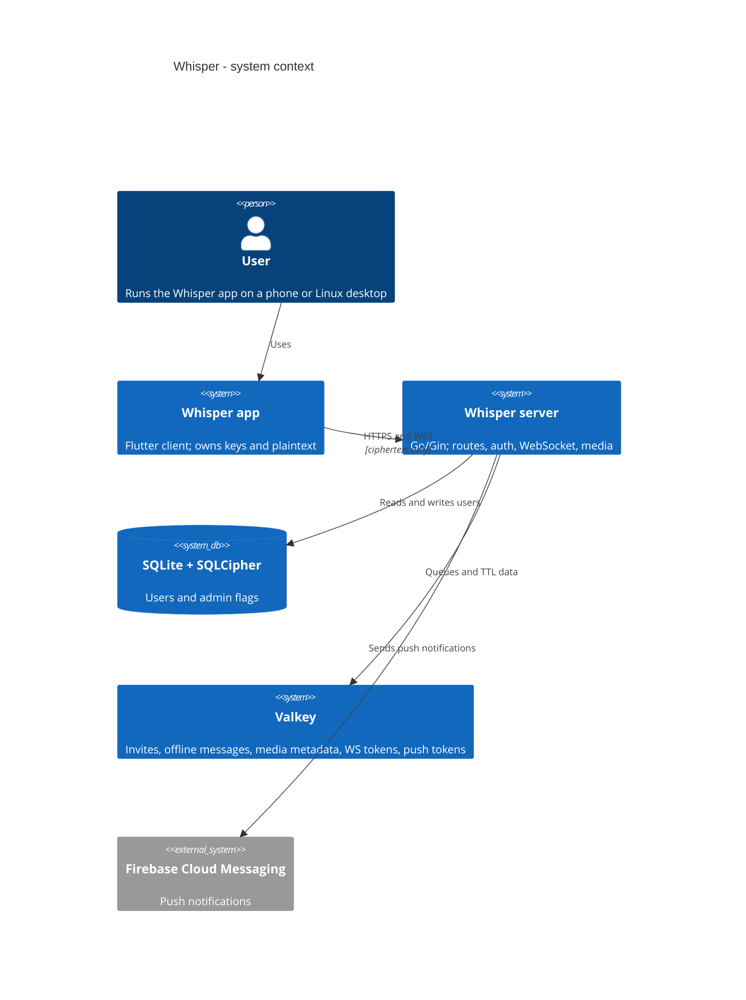
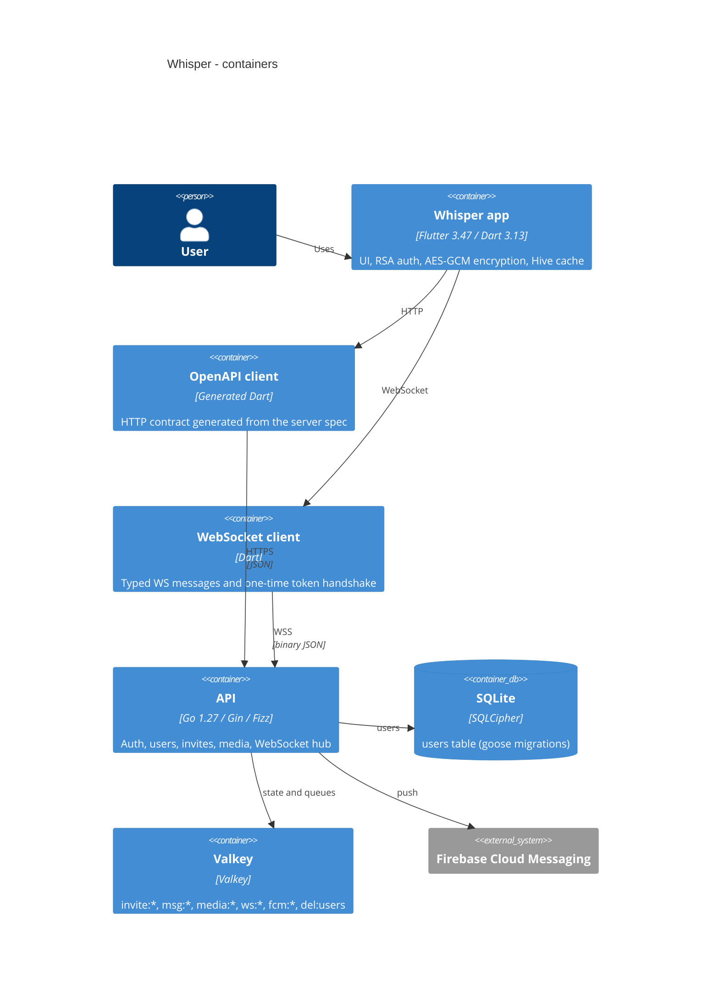

# Architecture

Whisper is four repositories with one runtime system. The app and both Dart
clients live on the device; the Go server is the only component that talks to
SQLite, Valkey and Firebase.

## System context

## Containers

The server never sees plaintext messages or media. It stores ciphertext in
transport, metadata in Valkey with a TTL, and the encrypted media blob on disk.

## Dependency rules

- `routes` only wires routes and middleware to handlers; no business logic.
- `handlers` may call `database`, `models` and existing `utils` helpers. They
  must not implement crypto or token logic themselves; that belongs in `utils`.
- `database` owns SQLite and Valkey access. It must not import `handlers`,
  `routes` or Gin.
- `utils` holds shared primitives (crypto, tokens, hub, logger). It must not
  import `handlers`, `routes` or `database`.
- Clients talk HTTP/WS only. They never know about SQLite, Valkey or the DB
  schema; the OpenAPI spec is the contract.
- The app never edits generated client code; contract changes go through
  `whisper-server` and `scripts/regen.sh`.

These rules are documented, not enforced by a linter: the handler rule is about
behaviour (not importing a package) and a `depguard` gate would not catch it.
Review and the `contract-change` skill are the enforcement.

## Deliberate non-goals

- No monorepo and no platform repository.
- No staging environment; production deploys are tag-driven.
- No component-level C4 diagrams; they would drift faster than they help.
